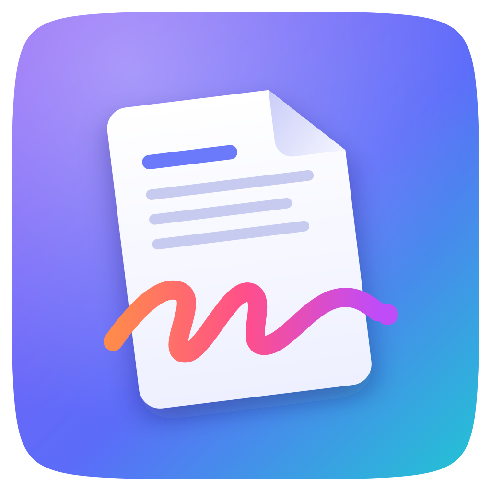

<p align="center"></p>

<h1 align="center">MiPDF</h1>

<p align="center">Editează, semnează și convertește PDF-uri. Pentru macOS, Windows și web, dintr-un singur cod.<br>
Totul se procesează local: fișierele nu pleacă nicăieri.</p>

## Ce face

| Funcție | Detalii |
| --- | --- |
| **Editare PDF** | Modifici textul existent (clic pe un rând), adaugi text, evidențiezi, desenezi, adaugi forme, imagini, acoperi zone. Undo/redo nelimitat. |
| **Pagini** | Miniaturi, reordonare prin drag & drop, rotire, ștergere, inserare din alt PDF, combinare de fișiere. |
| **Semnare** | Semnătură desenată (mouse, trackpad, deget), scrisă cu tastatura sau dintr-o imagine. Semnăturile se pot păstra pentru data viitoare. |
| **PDF → Word** | Reconstruiește paragrafe, titluri (Heading 1–3), bold/italic, liste cu buline, alinierea. Paginile scanate se păstrează ca imagine. |
| **Word → PDF** | Titluri, paragrafe, liste, tabele, imagini, linkuri, cu diacritice românești. |

Scurtături: `V` selectează, `E` editează text, `T` text, `H` evidențiază, `P` desen, `R` formă, `W` acoperă, `S` semnează, `⌘/Ctrl+Z` anulează, `⌘/Ctrl+S` salvează, `⌘/Ctrl +/-` zoom, `Delete` șterge obiectul selectat.

## Descărcare

- **macOS și Windows:** tab-ul **Actions → Aplicații desktop** din GitHub, ultima rulare verde → secțiunea *Artifacts*: `MiPDF-macOS` (.dmg, Apple Silicon + Intel) și `MiPDF-Windows` (.exe și .msi).
  La un tag `v1.0.0` se creează automat un Release (draft) cu instalatoarele.
- **Web:** `npm run build` produce un singur fișier `dist/index.html` care se poate pune pe orice hosting static. Workflow-ul *Website (GitHub Pages)* îl publică pe GitHub Pages.

> Instalatoarele nu sunt încă semnate digital. Pe Mac: clic dreapta pe aplicație → *Open* prima dată. Pe Windows: *More info → Run anyway*. Pentru semnare adaugă secretele `APPLE_*` (Apple Developer, 99 USD/an) și un certificat de cod pentru Windows.

## Arhitectură

```
src/                 interfața React + TypeScript (aceeași pe web, Mac și Windows)
  components/        Home, Editor, PageView, Thumbs, SignatureModal
  lib/
    pdfjs.ts         afișare PDF (PDF.js, în Web Worker)
    exportPdf.ts     scrie PDF-ul final: pagini, rotiri, text, desene, semnături (pdf-lib)
    pdfToWord.ts     PDF → .docx (analiză de layout + docx)
    wordToPdf.ts     .docx → PDF (mammoth + motor propriu de așezare în pagină)
    platform.ts      PlatformBridge: deschidere/salvare fișiere pe web vs. desktop
src-tauri/           shell-ul desktop Tauri 2 (Rust): ferestre, dialoguri native, asocierea fișierelor .pdf
tests/unit/          teste Vitest (export PDF, Word → PDF)
tests/e2e/           teste Playwright pe aplicația construită (Chromium + WebKit)
brand/               logo SVG și iconița aplicației
```

Toate dependențele au licențe permisive (MIT, Apache 2.0, BSD, OFL). Fontul pentru text este Liberation Sans (SIL OFL), compatibil metric cu Arial și cu toate diacriticele.

Planul pe termen lung (nucleu Rust pe PDFium, semnătură digitală cu certificat .p12, OCR) e descris în documentul de plan al proiectului; versiunea de acum are interfața și fluxurile complete, cu motoarele JavaScript.

## Dezvoltare

```bash
npm install
npm run dev            # website în browser, http://localhost:5173
npm run desktop:dev    # aplicația desktop (necesită Rust)
npm test               # teste unitare
npm run build && npx playwright install chromium webkit && npm run test:e2e
npm run desktop:build  # instalator pentru sistemul curent
```
